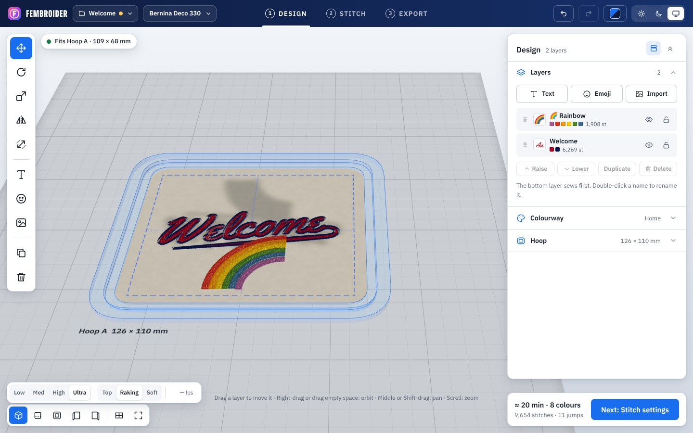
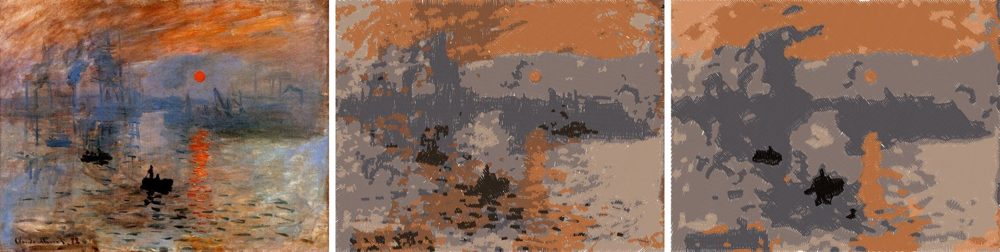
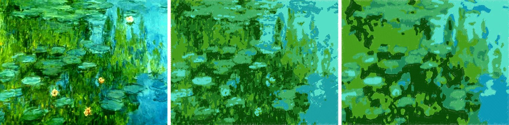
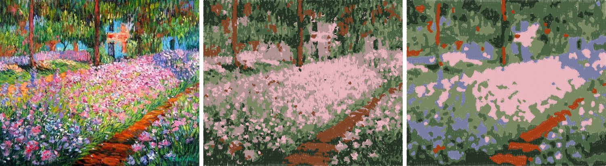
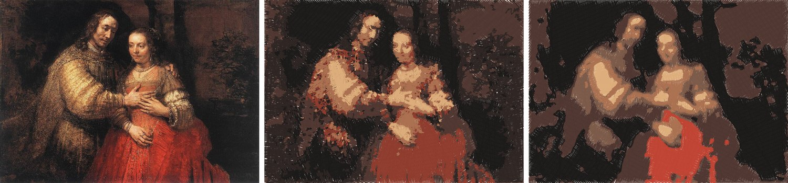
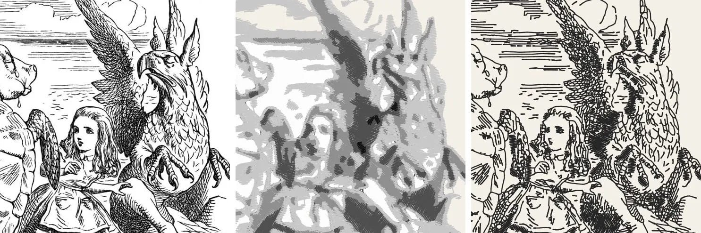
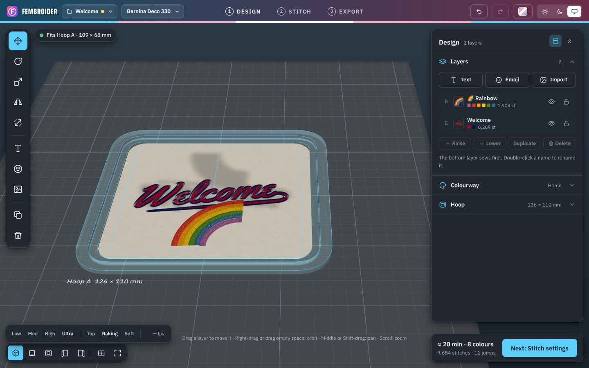

<h1 align="center">Fembroider</h1>

<b>Turn words, emoji and pictures into designs for your embroidery machine, and see exactly how they'll stitch before you sew.</b>

Free for Windows · No account · Works without the internet

<a href="https://github.com/ifloofie/Fembroider/releases/latest"><b>⬇ Download for Windows</b></a>

## What it does

- **Type a word and pick a font.** 50 fonts, from flowing scripts to bold varsity letters, with an optional swoop
  underneath, outlines and shadows.
- **Add an emoji.** Every emoji is ready to stitch, in its own colours.
- **Bring in your own pictures.** Logos, clipart, drawings, even paintings and photos. Fembroider picks the thread
  colours for you, or keeps the colours of an SVG.
- **Three ways to stitch a picture.** *Flat art* for logos, *Painting* for paintings and photos, *Line art* for
  drawings and engravings (examples below).
- **See it in 3D before you sew.** Every stitch is drawn in a real hoop on a real fabric, with the thread's sheen.
  Press *Play* to watch it stitch out in order.
- **Get the file your machine reads.** Choose your machine from the list and Fembroider saves the right kind of
  file, ready to copy to its USB stick or card, with a printable colour list.
- **Save your work as a project.** Projects keep everything, including your pictures, and Fembroider saves as you go,
  so closing the window never loses your design.

## Three ways to stitch a picture

When you import a picture, the **Artwork** setting decides how it becomes stitches. Fembroider picks Flat art or Painting for you, and
you can switch at any time and compare. (When a picture looks like a drawing, it suggests Line art.)

- **Flat art** keeps every edge sharp. Best for logos, clipart and cartoons with clean areas of colour.
- **Painting** smooths brushwork and grain into calmer patches of colour. Best for paintings and photos: they sew
  much faster and with far fewer *jumps* (each time the machine stops, ties off and moves to a new spot).
- **Line art** follows the lines of a drawing with fine running stitch and turns shading into stitched hatching,
  in one thread. Best for ink drawings, engravings and woodcuts.

### Paintings

Each example shows the original, then *Flat art*, then *Painting*, all at 12 cm with six thread colours.

Claude Monet, *Impression, Sunrise* (1872). Flat art: 314 jumps, about 50 minutes. Painting: 78 jumps, about 36 minutes.

Claude Monet, the Japanese footbridge at Giverny (1899). Flat art: 270 jumps, about 58 minutes. Painting: 81 jumps, about 41 minutes.
The grey-blue bridge keeps its own thread even though it's a small part of the picture.

Claude Monet, *The Artist's Garden at Giverny* (1900). Flat art: 594 jumps, about 81 minutes. Painting: 158 jumps, about 47 minutes.

Rembrandt, *The Jewish Bride* (about 1665). Flat art: 286 jumps, about 57 minutes. Painting: 27 jumps, about 33 minutes.

Flat art catches more of the brush texture; Painting gives you something you'll actually enjoy sewing. Try both.

### Line art

Most embroidery programs fill everything in, which turns a pen drawing into a blotchy shape. Fembroider can follow
the lines instead.

John Tenniel's illustration for *Alice's Adventures in Wonderland* (1865) at 15 cm. Left: the original. Middle:
filled in the usual way, five threads and about 51 minutes. Right: Fembroider's line art, one thread and about 34 minutes.

All the artworks shown are in the public domain.

## Works with your machine

Fembroider knows 197 home and commercial machines and their hoops, from **Brother, Baby Lock, Janome, Elna, BERNINA,
bernette, PFAFF, Husqvarna Viking, Singer, Poolin, Tajima, Barudan, Happy, SWF, ZSK, Melco** and **Ricoma**. Pick
yours from the list at the top and the hoop sizes and file type follow. It checks that your design fits the hoop
before you save it.

## Make it yours

Choose a colour theme for the app itself: Classic, or one inspired by a pride flag (Rainbow, Progress, Transgender,
Bisexual, Lesbian, Gay, Pansexual, Nonbinary, Asexual or Intersex), each in light and dark.

## Getting started

1. **Download** the installer from the [Releases page](https://github.com/ifloofie/Fembroider/releases/latest)
   (the file called `Fembroider-Setup-….exe`) and open it.
2. Windows may show *“Windows protected your PC”*. That's because Fembroider is new and not yet signed by a
   company. Click **More info**, then **Run anyway**.
3. In Fembroider, pick your **machine** at the top, then add **Text**, an **Emoji** or **Import** a picture.
4. When you're happy with the 3D preview, go to **Export** and save the file onto your machine's USB stick or card.

Already using Stitch Studio? Fembroider is its new name, and it picks up your Stitch Studio settings and last
design automatically.

## Questions

**Does it cost anything?** No. Fembroider is free and open source.

**Does it need the internet or an account?** No. Everything happens on your own computer, and nothing you make is
sent anywhere.

**Which file do I open on my machine?** Fembroider saves the type your machine reads (for example PES for Brother,
JEF for Janome, DST for commercial machines) and shows step-by-step instructions for your machine on the Export page.

**Where is my work saved?** Use *Project › Save* to keep a `.fembroider` file you can open again or share. On top of
that, Fembroider saves as you go and keeps earlier versions you can go back to (*Project › Version history*).

**My picture came out messy.** Try making it bigger, choosing fewer colours, or switching *Artwork* between
*Flat art*, *Painting* and *Line art*. Hover over any setting in the app for a short explanation.

## Credits

Fonts from Fontsource (SIL Open Font License and Apache 2.0). Emoji artwork by Twemoji © Twitter, Inc. and
contributors (CC-BY 4.0). Thread colour charts from the Ink/Stitch project (GPL-3.0). 3D drawing by three.js.
Machine and thread brand names belong to their owners.

Fembroider's own code is free to use and change under the MIT licence ([LICENSE](LICENSE)). If you'd like to help
build it, start with the [notes for developers](docs/DEVELOPING.md).
